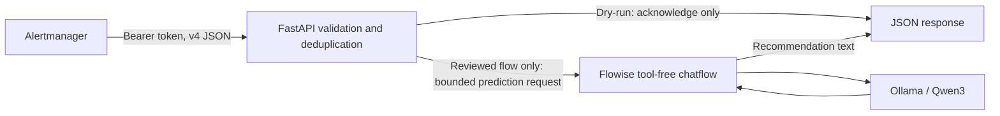

# Alertmanager webhook architecture

## Security boundary

The gateway has no shell runner, SSH, AWX, device credentials, Docker socket,
database credentials, or remediation endpoint. There is no switch to enable
remediation. It makes one configured Flowise prediction request per accepted
notification in live analysis mode. Dry-run makes no upstream requests.

The remote Flowise flow is a separate trust boundary. A prompt cannot prevent an
agent with action tools from using them. Use a dedicated **tool-free** chatflow
with only a prompt, Ollama/Qwen3 model, and output chain. Review it before setting
`FLOWISE_READ_ONLY_CONFIRMED=true`, restrict who can edit it, and review again after
changes. The confirmation setting records operator intent; it does not inspect
or constrain Flowise at runtime. The gateway cannot prove that an arbitrary
Flowise deployment is read-only. Model output is untrusted text requiring human
review, even when the prompt asks for safe checks.

## Request processing

1. Authenticate before reading the body using a constant-time bearer comparison.
   Startup fails without a non-placeholder token of at least 32 characters.
2. Accept JSON only, reject compressed bodies, cap streamed data at 64 KiB, and
   allow ten seconds to receive it. Uvicorn also bounds concurrent connections.
3. Validate v4 structure, timestamps with time zones, fingerprints, consistent
   group/alert states, one to twenty alerts, and bounded label/annotation maps.
   Reject unknown fields, truncated notifications, and malformed input with a
   generic error that does not echo the payload.
   Optional `routeLabels` and `notification_reason` metadata from current
   Alertmanager releases is bounded and accepted, but not forwarded.
4. Compute a SHA-256 identity from the sorted alert group. It includes labels,
   fingerprint, start time, status, and selected annotations. Firing `endsAt` is
   ignored because Alertmanager updates that expiry time. Resolved `endsAt` is
   included. A new start time, status, or selected annotation changes identity.
5. Successful notifications are suppressed for five minutes (up to 1,024 keys).
   Claims and success recording have no awaits, on one event loop. In-flight
   duplicates and excess upstream work receive retryable 503s, never false 200s.
6. Live mode sends an explicit JSON evidence block to a fixed URL/flow ID with
   bearer authentication. Only alertname, instance, job, severity, device,
   interface, ifName, site, summary, description, times, status, and fingerprint
   leave the gateway. Unknown fields and all supplied URLs are excluded.
7. Each attempt uses a new chat ID. No caller-supplied overrides, files, tools,
   history, or target URLs are forwarded. Redirects and environment proxies are
   disabled; TLS verification remains enabled. The total upstream deadline is
   45 seconds, the response limit is 64 KiB, and analysis is at most 16,000 chars.
8. Return plain analysis text in JSON; discard other upstream fields. Log only
   event hashes, counts, outcomes, and fixed error codes. Never log bodies,
   recommendations, authorization headers, or upstream error messages.

Allowed alert fields can still contain secrets; remove sensitive values at the
source. Field selection is data minimization, not a universal secret detector.
Flowise/Ollama may retain prompts and outputs under their own logging/storage
settings. Review their access and retention separately.

## Delivery guarantees and limits

This is synchronous, bounded lab integration with **at-least-once attempts**.
Failures are not cached. A 503 lets Alertmanager retry according to its own
backoff; the gateway does not perform hidden retries. A timeout may leave the
model generating an answer remotely, so a later attempt can duplicate inference.

Deduplication is per complete normalized group, in memory, for one process.
It resets on restart, expires after the TTL, and evicts oldest successes at the
capacity bound. Changed group membership produces a new analysis. It is not
durable incident tracking or ordering: an old firing notification arriving after
a resolution can still be analyzed. Use exactly one worker and one replica.
Before scaling or production use, add shared durable claims, a bounded queue,
incident storage, and an authenticated result retrieval design.

`/healthz` checks gateway availability and reports dry-run/analysis mode. It does
not query Flowise or guarantee model readiness. Alertmanager discards the
webhook response body. Retrieve recommendations using the manual fixture client
or Flowise's execution/chat history if enabled. This version does not add a
PostgreSQL incident schema or send Teams messages.

## Deployment boundary

The standalone Compose project attaches to the observed external network
`agent-lab_agent-net`. It creates only the webhook service and does not edit or
restart `/opt/agent-lab` services or volumes. The container has a non-root UID,
read-only root filesystem, all capabilities dropped, no-new-privileges, and CPU,
memory, process, and log limits. Its host port is bound to loopback.

Other containers on the shared network can reach it but still need its bearer
token. Network membership is not egress isolation: no firewall policy is supplied
here. Plain HTTP is allowed only by explicit opt-in for live analysis on the
trusted lab bridge; use authenticated TLS and restricted network access across
hosts. Do not expose the lab port publicly.

## Protocol references

- [Alertmanager webhook format, routing, and HTTP authorization](https://prometheus.io/docs/alerting/latest/configuration/)
- [Alertmanager v0.34.1 webhook metadata](https://github.com/prometheus/alertmanager/blob/v0.34.1/template/template.go)
- [Flowise prediction request and response](https://docs.flowiseai.com/using-flowise/prediction)
- [Flowise flow-level API key protection](https://docs.flowiseai.com/configuration/authorization/chatflow-level)
- [Flowise input interface, including chatId](https://github.com/FlowiseAI/Flowise/blob/main/packages/server/src/Interface.ts)
- [Docker Compose service isolation settings](https://docs.docker.com/reference/compose-file/services/)
